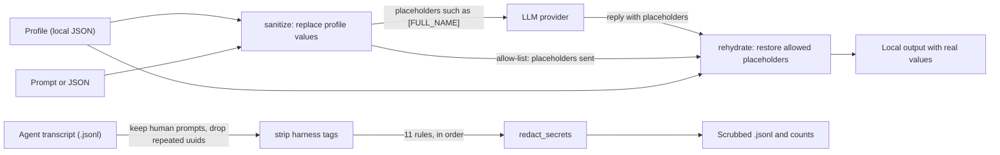

# llm-pii-airgap

A small local tool for people who use large language models (LLMs) and coding agents and
don't want their own personal details or secrets to leave their machine with a prompt or a
shared transcript. Python standard library only: nothing to install from a package index,
no network calls.

It does two jobs:

- **Prompt airgap.** You list your own details (name, email address, phone number, address,
  and anything else) in a local profile. Before a prompt goes to an LLM provider, the tool
  replaces each of those exact values with a placeholder such as `[FULL_NAME]`. When the
  reply comes back, it puts your real values back in, but only for the placeholders that you
  actually sent.
- **Transcript scrubber.** Before you share or publish a coding agent's `.jsonl` session
  log, it keeps only the human prompts and replaces secrets and common personal details
  (private keys, API keys, passwords, emails, IP addresses and so on) with labels such as
  `<SECRET>`.

What it is **not**: a PII detector. The airgap only finds the exact values you put in your
profile; it does not guess that a word is a name or an address. The scrubber is a fixed list
of patterns. Read [Limits](#limits) before relying on it, and see
[What to run alongside](#what-to-run-alongside) for tools that detect what this one misses.

The command names and the Python API use US spelling (`sanitize`, `tokenizer`); this README
uses British spelling for everything else.

## What's in it

| Part | What it does |
|---|---|
| `llm-pii-airgap sanitize` | Replaces your profile's values in text or JSON with placeholders, then re-checks its own result and refuses to write it if a value is still there. |
| `llm-pii-airgap rehydrate` | Puts your real values back into a model's reply, only for the placeholders you allow. |
| `llm-pii-airgap check` | Reports whether text still contains a profile value or a secret pattern (exit code 1 if so). Prints counts and field names only. |
| `llm-pii-airgap scrub` | Cleans an agent transcript (`.jsonl`): keeps human prompts, drops repeats and harness tags, replaces secrets. Prints counts only. |
| `src/llm_pii_airgap/tokenizer.py` | The profile (`IdentityProfile`) and the airgap (`PIIAirgap`): matching, placeholders, restoring. |
| `src/llm_pii_airgap/scrubber.py` | The scrubber rules (`REDACT_RULES`), harness-tag stripping and the transcript reader. |
| `src/llm_pii_airgap/cli.py` | The command-line tool, including the re-checks that also look inside JSON escapes and Unicode variants. |
| [`examples/profile.example.json`](examples/profile.example.json) | An example profile with made-up values. |
| [`CHECKLIST.md`](CHECKLIST.md) | What to check by hand before sending text to an LLM or publishing a dataset. |

## What it looks for

**The airgap** looks for the values in your profile, and nothing else. Each value matches:

- in any letter case, and with any whitespace inside it (a line break, a tab, several spaces
  or a non-breaking space where the profile has one space);
- only as a whole token: a profile value `Ann` is not replaced inside `Annual` or `Joanna`;
- for a phone number with at least 7 digits, whatever spaces, hyphens, dots and brackets sit
  between the digits; when the profile's number starts with `+`, the `+` is optional;
- in its ordinary form too, when the profile holds a decomposed accent or full-width
  characters (pasted from elsewhere, say). `rehydrate` gives back the value as the profile
  holds it.

When values overlap, the longer one wins if both start at the same place: an address that
contains your postal code is replaced whole. Placeholders that have been put in are never
matched again.

**The scrubber** runs these rules in this order. Each value it finds is replaced by the
rule's label; for `<SECRET>` the name in front of the value is kept.

| # | Label | What it matches | Example (made up) | Why it runs here |
|---|---|---|---|---|
| 1 | `<PRIVATE_KEY>` | A whole PEM private key block: five dashes and `BEGIN ... PRIVATE KEY`, the key lines, and any `END ... PRIVATE KEY` line after it (whether or not its label matches the `BEGIN` line) | an RSA, EC, OpenSSH or PKCS#8 private key file's contents | First, so the key's lines aren't split up by the later rules. |
| 2 | `<DISCORD_TOKEN>` | Three dot-separated parts: `M`, `N` or `O` and 23 to 25 more characters, then 6, then 27 to 40 | `M` + 24 characters `.` 6 characters `.` 28 characters | Before the generic rules, which would match the parts one by one. |
| 3 | `<API_KEY>` | `sk-` + 16 or more; `AIza` + 35; `ghp_`, `gho_`, `ghu_`, `ghs_` or `ghr_` + 30 or more; `xoxa-`, `xoxb-`, `xoxp-` or `xoxr-` + 10 or more; `AKIA` + 16 capitals or digits | `sk-` followed by 16 or more letters, digits, `_` or `-` | Before `<SECRET>`, so `GITHUB_TOKEN=` followed by a GitHub token becomes `GITHUB_TOKEN=<API_KEY>`. |
| 4 | `<URL_WITH_CREDS>` | A URL with a user name and password: `scheme://`, then `user:password` and `@` before the host, up to the next space (scheme in any case, up to 32 characters) | `https://user:` + password + `@registry.example.invalid/simple` | Before `<EMAIL>`, which would otherwise take only `password@host` and keep the user name. |
| 5 | `<PROXY_URI>` | `vless://`, `vmess://`, `trojan://`, `ss://`, `hysteria://`, `hysteria2://` and `hy2://` links | `vless://` + user ID + `@203.0.113.10:443` | Before `<UUID>` and `<IP>`, which would split the link. |
| 6 | `<UUID>` | Hexadecimal in 8-4-4-4-12 groups | `123e4567-e89b-12d3-a456-426614174000` | Before `<EMAIL>` and `<LONG_TOKEN>`. |
| 7 | `<EMAIL>` | `name@domain.tld` (excluding version-like domains such as `@1.2.3` or `@v4.2.2`) | `alex.example@example.invalid` | Before `<IP>` and `<SECRET>`, so an address is labelled as one. |
| 8 | `<IP>` | IPv4 addresses (`0`–`255` octets) | `203.0.113.10` | After the URL and email rules, which can contain one. |
| 9 | `<PHONE>` | `+`, a digit, then 8 or more digits, spaces, hyphens or brackets, ending in a digit (excluding `+YYYY-MM-DD` dates) | `+1 202 555 0143` | Before `<SECRET>`. |
| 10 | `<SECRET>` | A value after a secret-like name: `password`, `passwd`, `passphrase`, `pwd`, `pass`, `secret`, `token`, `credential(s)`, `authorization`, `api_key`, `access_key`, `private_key`, `auth_key`, `signing_key`, `encryption_key` or `..._KEY`, also inside longer names (`DB_PASSWORD`, `accessToken`, `db.password.prod`), as JSON keys, as `--password value` options and after `Bearer` | `DB_PASSWORD=FAKE` becomes `DB_PASSWORD=<SECRET>` | Late, so a value an earlier rule has already labelled keeps that label. |
| 11 | `<LONG_TOKEN>` | 40 or more letters, digits, `_`, `-`, `+` or `/` including at least one letter and one digit, with optional `=` padding | a 40-character git commit hash | Last, as a catch-all for long random strings. |

`<SECRET>` handles quoted values with spaces (`password = "two words"` becomes
`password = <SECRET>`), triple-quoted values (also across lines), `r"..."` and backtick
strings, YAML block scalars (`|`, `>-`), a value on the next line, a value continued onto
the next line with a trailing backslash (shell and `.env` style), a YAML list item,
`Authorization:` headers with any scheme word (`Token`, `ApiKey`, …), `os.getenv` /
`os.environ.get` defaults, chained assignments (`a_password = b_password = ...`), and values
in escaped JSON; if a quote is unclosed, it redacts to the end of the line.
It leaves alone plurals and longer words (`max_tokens`, `tokenizer`, `TOKENIZER`,
`secretary`, `token_type`, `PASS_RATE`), bare `true`, `false`, `null` and `none`, and values
that are already a placeholder (`<YOUR_API_KEY>`). A secret-named key never takes the next
key as its value: in `{"token": {"access_token": ...}}` the inner value is the one replaced.
Running the scrubber again on its own output finds nothing new.

The transcript reader (`scrub`) keeps only records of type `user` that a person typed: it
skips model replies, sub-agent and side-chain records, meta and summary records, records
carrying tool results (unless `--keep-tool-results`), and messages that start with a harness
prefix such as `<task-notification` or `[Request interrupted` (checked before and after tag
stripping). Records with a `uuid` already seen are dropped. It removes harness blocks
(`<system-reminder>`, `<side-sessions-event>`, `<scheduled-task>`, `<task-notification>`,
`<ci-monitor-event>`, `<local-command>`, `<pasted_content...>`, `<ide_...>`, `<attachment>`)
and `[Image #...]` and `[Pasted text #...]` markers (preserving Markdown image links), then
runs the rules above.

## Requirements

- Python 3.11 or newer. Nothing else.
- Tested locally on Windows 11 with Python 3.11 to 3.13. CI runs the tests on Linux, macOS
  and Windows with Python 3.11 to 3.14.

## Install

From a release tag:

```sh
pip install "git+https://github.com/ltchaotic23/llm-pii-airgap@v0.2.0"
```

Or from source:

```sh
git clone https://github.com/ltchaotic23/llm-pii-airgap.git
cd llm-pii-airgap
pip install .
```

Check what is installed with `llm-pii-airgap --version`. To run it without installing, set
`PYTHONPATH=src` and use `python -m llm_pii_airgap.cli` in place of `llm-pii-airgap`.

**Windows PowerShell 5.1** (the `powershell.exe` built into Windows) changes text on its way
through a pipe: accented letters arrive as `?`, so `José` can no longer match. It also
re-encodes output redirected with `>`. Pass files with `-i` and `-o` instead of pipes and
redirection there. PowerShell 7 (`pwsh`) does not have this problem. The tool always reads
and writes UTF-8.

## Configure: the profile

The profile is a JSON file on your own machine. Keep it out of git: this repository's
`.gitignore` already ignores `*.local.json` and `profile.json`, so a name such as
`profile.local.json` is a good choice. Start from
[`examples/profile.example.json`](examples/profile.example.json):

```json
{
  "full_name": "Alex Example",
  "email": "alex.example@example.invalid",
  "phone": "+1 202 555 0143",
  "street_address": "100 Maple Avenue, Springfield",
  "postal_code": "12345",
  "custom_fields": {
    "employee_id": "EMP-9042",
    "badge_number": null
  }
}
```

| Key | Placeholder | Notes |
|---|---|---|
| `full_name` | `[FULL_NAME]` | |
| `email` | `[EMAIL]` | |
| `phone` | `[PHONE]` | With 7 or more digits, matched whatever the separators (see above). Write it with the digits you use: `+1 202 555 0143` does not match `202 555 0143`. |
| `street_address` | `[ADDRESS]` | |
| `postal_code` | `[POSTAL_CODE]` | |
| `custom_fields` | `[CUSTOM_<NAME>]` | An object of name to value, for anything else: a first name on its own, a nickname, a username, an ID. The name is upper-cased and each run of non-ASCII letters/digits becomes `_`, so `employee id` gives `[CUSTOM_EMPLOYEE_ID]` and `prénom` gives `[CUSTOM_PR_NOM]`; a name with no ASCII letters or digits gives `[CUSTOM_FIELD]`. |

Rules:

- Every value is a string. `null` (or a missing key) means "not set", for the main keys and
  for a custom field's value; `"custom_fields": null` means no custom fields.
- Values are trimmed, and a blank value counts as not set.
- Every value needs at least 3 characters once trimmed: a shorter one would be replaced
  inside unrelated text.
- A file saved with a byte order mark (as Notepad and Windows PowerShell 5.1 do) is fine.

A profile that would protect less than you think is refused instead of loaded. The command
stops with exit code 2 and one of these messages (the names and values here are examples):

| Problem | Message |
|---|---|
| A key that isn't listed above (a typo such as `fullname`) | `Unknown profile field(s): fullname. Known fields are full_name, email, phone, street_address, postal_code; put anything else under 'custom_fields'.` |
| The same key twice | `Duplicate key 'full_name' in identity profile JSON.` |
| Not a JSON object | `Identity profile JSON must contain an object at the root.` |
| A main value that isn't a string | `Profile field 'phone' must be a string.` |
| A `phone` value with no digits | `Profile field 'phone' must contain at least one digit.` |
| `custom_fields` that isn't an object | `'custom_fields' must be an object mapping names to strings.` |
| A custom value that isn't a string | `Custom field 'employee_id' must map a string name to a string value.` |
| Two custom names with the same placeholder | `Custom fields 'employee id' and 'employee-id' both map to placeholder [CUSTOM_EMPLOYEE_ID]; rename one.` |
| No values at all | `Identity profile has no values to protect.` |
| A value under 3 characters | `Profile value for [CUSTOM_INITIALS] is shorter than 3 characters and cannot be matched without corrupting unrelated text.` |

A file that isn't valid JSON, or can't be read, gives Python's own message for that.
Messages name keys and placeholders, never your values.

## Use it from the command line

Every command reads UTF-8 and writes UTF-8. For `sanitize`, `rehydrate` and `check`, input
comes from `-t TEXT` (inline; it stays in your shell history, so prefer `-i` for anything
private) or `-i FILE`, where `-i -` reads standard input; `scrub` takes `-i FILE` and
`-o FILE`. Input that isn't UTF-8, including UTF-16 (which contains NUL characters), is
refused with exit code 2 rather than guessed at.

Exit codes:

| Command | 0 | 1 | 2 |
|---|---|---|---|
| `sanitize` | written | (not used) | error, a refused profile, or a value still present after sanitising (nothing is written) |
| `rehydrate` | written | (not used) | error, or a refused profile (nothing is written) |
| `check` | clean | a profile value or secret pattern was found | error, or a refused profile |
| `scrub` | written | (not used) | error (nothing is written) |

A mistake in the arguments also exits with 2. The error message never repeats what you
typed, because a stray word of unquoted `-t` text could be a name or a password:

```text
llm-pii-airgap: error: unrecognized arguments (not shown; put text with spaces in quotes)
```

### sanitize

```sh
llm-pii-airgap sanitize -p PROFILE (-t TEXT | -i INPUT) [-o OUTPUT] [--json]
```

Replaces profile values with placeholders and writes the result to `-o`, or prints it.

- `--json` reads the input as one JSON document or, failing that, as JSON Lines, and
  replaces values in keys, strings and numbers (a phone number stored as a number becomes
  the string `"[PHONE]"`). One invalid line fails the whole input.
- Before writing, it checks its own result again, as written, with JSON escapes decoded,
  and with Unicode variants normalised. If a profile value is still there, it writes nothing
  and exits with 2. Plain-text mode can't replace a value hidden behind a JSON escape (the
  error says to use `--json`); neither mode replaces a value escaped inside JSON that is
  nested in a JSON string, or a value written with a decomposed accent, a zero-width
  character or full-width digits (the error says to normalise the text first).

<!-- sample: sanitize -->
```text
$ llm-pii-airgap sanitize -p examples/profile.example.json -t "Write to Alex Example at alex.example@example.invalid"
Write to [FULL_NAME] at [EMAIL]
```

### rehydrate

```sh
llm-pii-airgap rehydrate -p PROFILE (-t TEXT | -i INPUT) (--allow-from SENT_PROMPT | --allow-all) [-o OUTPUT] [--json]
```

Puts real values back in place of placeholders. A model's reply can't be trusted: a prompt
injection could ask it to print `[ADDRESS]` even though your prompt never contained your
address. So you must choose:

- `--allow-from FILE`: only restore the placeholders that appear in `FILE`, the prompt you
  actually sent. This is the safe choice.
- `--allow-all`: restore every placeholder the profile knows.

Placeholders that aren't allowed stay as they are. The output contains your real details:
see [Privacy and network use](#privacy-and-network-use).

<!-- sample: rehydrate -->
```text
$ llm-pii-airgap rehydrate -p examples/profile.example.json -t "Dear [FULL_NAME], we will ship to [ADDRESS]." --allow-from sent.txt
Dear Alex Example, we will ship to [ADDRESS].
```

Here `sent.txt` held the prompt `Write to [FULL_NAME] at [EMAIL]`, so `[ADDRESS]` was not
restored.

### check

```sh
llm-pii-airgap check (-t TEXT | -i INPUT) [-p PROFILE]
```

Scans text for the scrubber's patterns and, with `-p`, for profile values. It looks at the
text as written, with JSON escapes decoded (up to four levels of JSON inside JSON), and with
invisible characters removed and Unicode normalised (NFKC), so `José` written as a JSON
escape, an address split by `\n`, or a name with a zero-width space inside it is still
found. It prints a report with counts and field names only, never the matched text.

<!-- sample: check -->
```text
$ llm-pii-airgap check -p examples/profile.example.json -t "Alex Example, DB_PASSWORD=FAKE, 203.0.113.9 and 198.51.100.7"
{
  "clean": false,
  "secret_pattern_counts": {
    "<IP>": 2,
    "<SECRET>": 1
  },
  "raw_profile_fields_detected": [
    "[FULL_NAME]"
  ]
}
```

### scrub

```sh
llm-pii-airgap scrub -i INPUT.jsonl -o OUTPUT.jsonl [--keep-tool-results]
```

Reads an agent transcript and writes one JSON object per kept prompt:
`{"uuid": ..., "timestamp": ..., "text": ...}`. The `uuid` and `timestamp` fields are copied
as they are. It creates the output's folder if needed and prints a summary of counts.

- `--keep-tool-results` keeps the typed text of user records that also carry tool results.
  The tool output itself is never kept.
- A line that isn't valid JSON (or is nested too deeply or holds an integer too large to read)
  is counted under `invalid_json` and skipped; the rest of the file is still processed.
  Non-UTF-8 or UTF-16 input is refused with exit code 2 without writing output.

For this four-line transcript:

<!-- sample: scrub-input -->
```json
{"type": "user", "uuid": "1", "message": {"content": "Deploy with DB_PASSWORD=FAKE to 203.0.113.9"}}
{"type": "assistant", "uuid": "2", "message": {"content": "Done."}}
{"type": "user", "uuid": "1", "message": {"content": "Deploy with DB_PASSWORD=FAKE to 203.0.113.9"}}
{"type": "user", "uuid": "3", "message": {"content": "<system-reminder>context</system-reminder>Thanks, alex.example@example.invalid"}}
```

it prints:

<!-- sample: scrub-summary -->
```text
$ llm-pii-airgap scrub -i session.jsonl -o session.clean.jsonl
{
  "lines_read": 4,
  "rows_kept": 2,
  "duplicates_skipped": 1,
  "invalid_json": 0,
  "non_user_skipped": 1,
  "redactions": {
    "<IP>": 1,
    "<SECRET>": 1,
    "<EMAIL>": 1
  }
}
```

and writes:

<!-- sample: scrub-output -->
```json
{"uuid": "1", "timestamp": null, "text": "Deploy with DB_PASSWORD=<SECRET> to <IP>"}
{"uuid": "3", "timestamp": null, "text": "Thanks, <EMAIL>"}
```

## Use it from Python

```python
from llm_pii_airgap import IdentityProfile, PIIAirgap

profile = IdentityProfile(
    full_name="Alex Example",
    email="alex.example@example.invalid",
    phone="+1 202 555 0143",
    street_address="100 Maple Avenue, Springfield",
    postal_code="12345",
    custom_fields={"employee_id": "EMP-9042"},
)
# Or load one: IdentityProfile.from_json_file("profile.local.json")
airgap = PIIAirgap(profile)

sent = airgap.sanitize_prompt("Draft a reply for Alex Example at alex.example@example.invalid.")
assert sent == "Draft a reply for [FULL_NAME] at [EMAIL]."

reply = "Hello [FULL_NAME], your contact [EMAIL] is confirmed. Ship to [ADDRESS]."
final = airgap.rehydrate(reply, allow=airgap.placeholders_in(sent))
assert final == "Hello Alex Example, your contact alex.example@example.invalid is confirmed. Ship to [ADDRESS]."
```

| Name | What it does |
|---|---|
| `IdentityProfile(full_name="", email="", phone="", street_address="", postal_code="", custom_fields={})` | A profile. Refuses non-string values and colliding custom names with `ValueError`. |
| `IdentityProfile.from_json_file(path)` | Loads and validates a profile file (see [the profile](#configure-the-profile)). |
| `profile.placeholder_map()` | `{placeholder: value}` for every value that is set. |
| `PIIAirgap(profile)` | Builds the matcher. Refuses an empty profile or a value under 3 characters with `ValueError`. |
| `airgap.sanitize_prompt(text)` | Text with profile values replaced. |
| `airgap.sanitize_payload(obj)` | The same for JSON-like data: keys, strings, numbers, lists, tuples and dicts; `None` and booleans pass through. Raises `TypeError` for anything else (bytes, sets) rather than passing it through unchecked. |
| `airgap.placeholders_in(text)` | The set of known placeholders in `text`: use it as the allow-list. |
| `airgap.rehydrate(payload, *, allow)` | Restores only the placeholders in `allow`, in text or JSON-like data. `allow` is required: pass `placeholders_in(sent)`, or `profile.placeholder_map().keys()` to restore everything. `None`, a string or non-string items in `allow`, unsupported payload types (`bytes`, `set`), or colliding dict keys raise `TypeError` or `ValueError`. |
| `airgap.contains_raw_pii(text)` | The placeholders whose values appear in `text`. |
| `redact_secrets(text)` | `(scrubbed_text, {label: count})`. |
| `strip_harness_tags(text)` | Text without harness blocks and markers. |
| `scrub_jsonl_stream(lines, *, drop_tool_results=True)` | `(rows, summary)` for an iterable of JSONL lines, as `scrub` writes and prints them. |
| `REDACT_RULES` | The `(label, compiled pattern)` pairs, in the order they run. Use them through `redact_secrets`: it also stops the `<PRIVATE_KEY>` search at the last `END` line, which keeps that rule fast on crafted input. |

```python
from llm_pii_airgap import redact_secrets, scrub_jsonl_stream, strip_harness_tags

assert redact_secrets("DB_PASSWORD=FAKE on 203.0.113.9") == ("DB_PASSWORD=<SECRET> on <IP>", {"<IP>": 1, "<SECRET>": 1})
assert strip_harness_tags("Hi <system-reminder>context</system-reminder>there") == "Hi there"
rows, summary = scrub_jsonl_stream(['{"type": "user", "uuid": "1", "message": {"content": "mail alex@example.invalid"}}'])
assert rows == [{"uuid": "1", "timestamp": None, "text": "mail <EMAIL>"}]
```

The library calls don't run the extra re-check that the `sanitize` command does (JSON
escapes and Unicode variants). If you sanitise from Python, also run `check` on the result,
or use the command.

## Recipes

### A safe round trip

```sh
llm-pii-airgap sanitize -p profile.local.json -i draft.txt -o sent.txt
# Send sent.txt to the model and save its reply as reply.txt. Then:
llm-pii-airgap rehydrate -p profile.local.json -i reply.txt --allow-from sent.txt -o final.txt
```

`final.txt` now holds your real details: keep it local. If your draft itself contains text
that looks like a placeholder (a template with a literal `[EMAIL]` slot), that placeholder is
in `sent.txt` too, so `--allow-from` lets the model's `[EMAIL]` be filled in. From Python,
allow only what `sanitize` actually replaced:

```python
from llm_pii_airgap import IdentityProfile, PIIAirgap

airgap = PIIAirgap(IdentityProfile(full_name="Alex Example", email="alex.example@example.invalid"))
draft = "Fill in this template: Dear [FULL_NAME]. Sign it from alex.example@example.invalid."
sent = airgap.sanitize_prompt(draft)
allow = airgap.placeholders_in(sent) - airgap.placeholders_in(draft)
assert allow == {"[EMAIL]"}
assert airgap.rehydrate("Dear [FULL_NAME], from [EMAIL]", allow=allow) == "Dear [FULL_NAME], from alex.example@example.invalid"
```

### Cleaning an agent transcript before sharing it

```sh
llm-pii-airgap scrub -i session.jsonl -o session.clean.jsonl
llm-pii-airgap check -p profile.local.json -i session.clean.jsonl
```

Then read the result yourself (see [CHECKLIST.md](CHECKLIST.md)). `check` on scrubbed output
reports the records' own `uuid` values as `<UUID>` when they are UUIDs; that is expected.
Anything else it reports is something the scrubber missed, or a profile value, which `scrub`
doesn't look for.

### A last gate before uploading or committing

```sh
llm-pii-airgap check -p profile.local.json -i outbound.txt || echo "Not clean: don't send it"
```

`check` exits with 1 when it finds something and 2 when it can't run, so treat anything
other than 0 as "stop". For a git repository, a commit-time scanner such as
[repo-privacy-guard](https://github.com/ltchaotic23/repo-privacy-guard) covers every commit
and push; `check` covers a single file or prompt.

## How it works



- **One pass, longest first.** All profile values go into one regular expression, longest
  first, and the text is scanned once. Replacing values one after another would let a short
  value (the postal code) break up a longer one (the address that contains it), and could
  match inside placeholders already put in.
- **Refuse rather than skip.** A value the tool can't match safely (too short, misspelt key,
  wrong type, colliding names) stops it, instead of being dropped quietly, because a dropped
  field would pass through unprotected.
- **Re-check before writing.** `sanitize` scans its own result in every view `check` uses
  and writes nothing if a value survived.
- **Counts, not content.** `check` and `scrub` print labels and counts only. Error messages
  name keys, placeholders and files. Argument errors don't repeat what you typed.
- **Linear time.** Matching, scrubbing and tag stripping are written so that crafted input
  can't make them slow down sharply (catastrophic backtracking); the tests time each rule
  against worst-case input and check that four times the input takes less than eight times
  as long (linear code takes four times as long, quadratic code sixteen), on inputs large
  enough to time reliably and to be past the point where the processor's cache flatters the
  smaller run.

## Threat model

**What it protects:**

- the values you list in your profile, in prompts and JSON you send to an LLM provider;
- secrets and common personal details in agent transcripts you share or publish.

**Who it protects them from:**

- the LLM provider: its servers, logs, staff and anything trained on what you send;
- anyone who reads a dataset or transcript you publish;
- a model reply steered by prompt injection into asking for placeholders your prompt never
  contained (the allow-list in `rehydrate`).

**What is out of scope:**

- your own disk, including the profile file itself, the rehydrated output and any other
  file on your machine. Keep the profile out of git (`.gitignore` already covers
  `*.local.json` and `profile.json`).
- anything the model can work out from what remains: other details in the prompt, your
  writing, the context of the conversation.
- the placeholders themselves: `[ADDRESS]` tells the provider that an address was there,
  and which kinds of personal data your prompt contained.
- personal details that aren't in your profile, and secret formats the scrubber doesn't
  know (see [Limits](#limits)).
- malware or another user on your machine.

## Limits

Please read these before relying on the tool. Each one has a test that asserts today's
behaviour, so a limit can't change without this list changing too.

- **It only finds the exact values in your profile.** It misses details that aren't in the
  profile, misspellings, nicknames, initials, transliterations and look-alike letters, and
  parts of a value: with only `full_name` set, `Alex wrote this` stays as it is. Add each
  form you use as a custom field.
- **Phone numbers follow the digits as written.** A profile value of `+1 202 555 0143` does
  not match `202 555 0143` or `001 202 555 0143`. Add the other forms as custom fields.
- **A value split up or reformatted is missed**: first and last name under different JSON
  keys (`{"first": "Alex", "last": "Example"}`), an address without its comma
  (`100 Maple Avenue Springfield`), or a name broken by markup (`**Alex** Example`,
  `<b>Alex</b> Example`).
- **Encoded values are missed**: HTML entities (`alex.example&#64;example.invalid`),
  URL encoding (`alex.example%40example.invalid`) and base64.
- **Some Unicode variants are missed.** Decomposed accents, zero-width and other invisible
  characters, and full-width letters and digits are found by `check` and make `sanitize`
  refuse, but `sanitize` does not replace them. Variants that no normalisation maps are
  missed everywhere: `GROSSE STRASSE 5` for `Große Straße 5`, a curly apostrophe for a
  straight one (`O’Brien`).
- **Longest-first only decides between values that start at the same place.** With the
  name `Alex Example` and the address `Example Street 42`, the text `Alex Example Street 42`
  becomes `[FULL_NAME] Street 42`, and the rest of the address isn't reported.
- **JSON has limits.** Plain-text `sanitize` can't replace a value behind a JSON escape: it
  stops and asks for `--json`. JSON nested inside a JSON string is detected up to four
  nested levels (five or more levels are missed) and not unpacked, so `sanitize --json`
  stops too when the nested value is escaped. A number replaced by
  `sanitize --json` comes back from `rehydrate` as a string (`12345` becomes `"12345"`), and
  a number whose digits contain a value becomes a string too (`12345.5` becomes
  `"[POSTAL_CODE].5"`).
- **Rehydrated values use the profile's spelling.** `Signed, ALEX` and a line break and
  `EXAMPLE` comes back as `Signed, Alex Example`: the letter case and the whitespace of the
  original are not kept.
- **A placeholder you typed yourself counts as sent.** If your prompt contains a literal
  `[EMAIL]`, `rehydrate --allow-from` fills in the model's `[EMAIL]` with your real address.
  See [the round-trip recipe](#a-safe-round-trip) for the Python workaround.
- **Windows PowerShell 5.1 pipes** replace accented letters with `?` before the tool sees
  them; see [Install](#install).
- **The scrubber is a fixed list of patterns.** It misses token formats it doesn't know
  (GitLab `glpat-`, Hugging Face `hf_` and many more), PGP private key blocks and key blocks
  with no `END` line (their long lines are caught one by one by `<LONG_TOKEN>`, the header
  is kept), short JSON Web Tokens, IPv6 addresses, phone numbers without a leading `+`
  (`202 555 0143`), and home-folder paths
  (`C:\Users\exampleuser\notes.txt`).
- **`<SECRET>` needs a recognisable name next to the value.** It misses a secret in prose
  (`the password is ...`), after a short option (`mysql -p...`), in the second and later
  items of a YAML list, under a nested key with an ordinary name (`token:` then
  `value: ...`), and split across lines or JSON fields.
- **It over-redacts some things.** For example: full git commit hashes and SHA-256 hashes,
  long paths and long `https://` URLs that contain a digit, and base64 data inside text
  become `<LONG_TOKEN>`; four-part version numbers (`1.26.4.0`) become `<IP>`; a git SSH
  remote (`git@github.com:...`) and systemd template units (`openvpn@server.service`) become
  `<EMAIL>`; `+1000000000` becomes `<PHONE>`; and code that only names a secret
  (`def login(password: str) -> bool:`, `interface AuthConfig { accessToken: string; }`,
  `password_hash = ...`, `API_KEY=os.environ[...]`, `secret_name: my-tls-cert`) or prose
  such as `the secret: keep it simple` loses the word after the name.
- **Harness tags are removed only when they are well formed.** An unclosed
  `<system-reminder>` is kept whole; a block nested inside another of the same kind leaves
  a tail; `<command-...>` blocks are dropped only when a message starts with them (including
  after leading harness blocks are removed).
- **`scrub` copies `uuid` and `timestamp` as they are**, without scanning them.
- **Rehydrated text contains your real details.** Never send it back to a model or to
  anywhere you don't trust.

### Tested and not tested

| Limit or claim | Test |
|---|---|
| Only exact profile values | `test_misses_corpus.TestTokenizerLimits.test_only_exact_profile_values_are_found` |
| Phone digits as written | `test_misses_corpus.TestTokenizerLimits.test_phone_numbers_follow_the_digits_as_written` |
| Split or reformatted values | `test_misses_corpus.TestTokenizerLimits.test_split_or_reformatted_values_are_missed` |
| Encoded values | `test_misses_corpus.TestTokenizerLimits.test_encoded_values_are_missed` |
| Unicode variants found by `check` | `test_bypasses.TestVariantsTheRecheckCatches.test_check_finds_each_variant` |
| Unicode variants that make `sanitize` refuse | `test_bypasses.TestVariantsTheRecheckCatches.test_sanitize_refuses_rather_than_writing_a_variant` |
| Unicode variants missed everywhere | `test_misses_corpus.TestTokenizerLimits.test_unicode_variants_that_no_normalisation_maps` |
| Overlapping values | `test_misses_corpus.TestTokenizerLimits.test_overlapping_values_that_start_at_different_points` |
| JSON escapes, nested JSON and numbers | `test_misses_corpus.TestTokenizerLimits.test_json_escapes_nested_json_and_numbers` |
| Number containing a value | `test_json.TestJsonShapes.test_array_root_and_scalars` |
| Profile spelling on rehydrate | `test_misses_corpus.TestTokenizerLimits.test_rehydrate_restores_the_profile_spelling` |
| A placeholder you typed yourself | `test_misses_corpus.TestTokenizerLimits.test_literal_placeholder_in_the_prompt_is_restored` |
| Workaround for typed placeholders | `test_bypasses.TestPlaceholderCollision.test_subtracting_the_original_keeps_only_real_substitutions` |
| Windows PowerShell 5.1 pipes | Not tested automatically: it happens inside Windows PowerShell 5.1 before the tool runs. `test_encoding.TestPipedInputEncoding` covers UTF-8 arriving through a legacy code page. |
| Unknown secret formats | `test_misses_corpus.TestScrubberLimits.test_unknown_formats_are_missed` |
| Long key lines caught one by one | `test_misses_corpus.TestScrubberLimits.test_long_key_lines_are_caught_only_by_the_generic_rule` |
| `<SECRET>` needs a name | `test_misses_corpus.TestScrubberLimits.test_secret_rule_needs_a_name_next_to_the_value` |
| Over-redaction | `test_misses_corpus.TestScrubberLimits.test_over_redaction` |
| Harness-tag gaps | `test_misses_corpus.TestScrubberLimits.test_harness_tag_gaps` |
| `uuid` and `timestamp` copied | `test_misses_corpus.TestScrubberLimits.test_scrub_copies_uuid_and_timestamp` |
| Rehydrated text contains real details | Not a code behaviour: a rule for you. |
| Nothing is ever printed but counts and names | `test_no_echo.TestNoEcho` (every command and error path, in a separate process) |
| No false alarms on common snippets | `test_noise_corpus` |
| Linear time on crafted input | `test_performance` |
| Real transcripts and prompts | Not tested: all test data is made up. Over-redaction on real transcripts hasn't been measured. |

## What to run alongside

This tool matches exact values and a fixed list of patterns. When you need *detection* of
personal details you didn't list, or of secret formats it doesn't know, add another tool.
These are options, not dependencies:

- a PII detector such as [Microsoft Presidio](https://github.com/microsoft/presidio), which
  finds names, addresses and other details by pattern and language model;
- a secret scanner such as [gitleaks](https://github.com/gitleaks/gitleaks), and GitHub
  secret scanning with push protection, for repositories;
- [repo-privacy-guard](https://github.com/ltchaotic23/repo-privacy-guard), git hooks that
  block secrets and personal details at commit and push time.

## Privacy and network use

- It makes **no network calls** and sends **no telemetry**. Everything runs on your machine.
- It reads only the files you name (`-p`, `-i`, `--allow-from`) and writes only the file you
  name with `-o` (for `scrub`, creating its folder if needed).
- `check` and `scrub` print counts and labels only. `sanitize` prints the sanitised text when
  you don't give `-o`. Error messages name keys, placeholders and files, never values.
- `rehydrate` output contains your **real personal details**, whether printed or written to
  a file. Treat it like the profile.
- Text given with `-t` stays in your shell history. Use `-i` for anything private.

## Development

```sh
python -m unittest discover -s tests -v
```

With the package not installed, set `PYTHONPATH=src` first. The tests are split by concern:

| File | What it covers |
|---|---|
| `test_profile.py` | Profile validation and every refusal message |
| `test_tokenizer.py` | Matching: longest first, whole tokens, case, whitespace, phone numbers |
| `test_rehydrate.py` | The allow-list, nested data, injected placeholders |
| `test_roundtrip.py` | Sanitise then rehydrate, including seeded random text and JSON |
| `test_scrubber_rules.py` | Each scrubber rule: a match, a near miss and its order |
| `test_scrubber_stream.py` | Transcript filtering, de-duplication, harness tags, bad lines |
| `test_cli.py` | Every command, option and exit code |
| `test_json.py` | JSON keys, numbers, JSON Lines, escapes, nested JSON |
| `test_encoding.py` | UTF-8 with and without a byte order mark, UTF-16, legacy code pages, line endings, empty and long input |
| `test_no_echo.py` | Nothing protected is ever printed, on any path |
| `test_bypasses.py` | Adversarial input: Unicode tricks, quoting, placeholder collisions |
| `test_noise_corpus.py` | Snippets that must stay unchanged (false alarms) |
| `test_misses_corpus.py` | One test per item in [Limits](#limits) |
| `test_performance.py` | A 10 MB transcript, worst-case input for every pattern, big profiles |
| `test_docs.py` | This README: its examples run, its samples match real output, its tables match the code |
| `test_packaging.py` | The built wheel holds only the package; the installed command's `--version` and `--help` work. Skipped unless `AIRGAP_WHEEL_DIR` and `AIRGAP_INSTALLED=1` are set, as CI does after building and installing the wheel. |

All test data is made up: reserved example domains, documentation IP ranges, fictional
phone numbers and plainly invented names. Fake secrets are assembled at run time from
fragments, so the repository never holds a whole token-shaped string.

See [CHANGELOG.md](CHANGELOG.md) for changes between versions, and
[SECURITY.md](SECURITY.md) to report a vulnerability.

## Licence

MIT. See [LICENSE](LICENSE).
