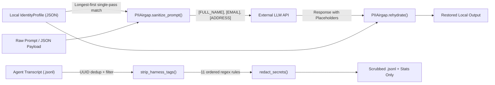

# llm-pii-airgap

Deterministic client-side **PII tokenisation airgap** and **JSONL agent transcript secret scrubber** for LLM workflows. Zero runtime dependencies (`Python >= 3.10`).

## Threat Model & Architecture

Sending raw user profiles or coding-agent session logs to external LLM APIs or fine-tuning datasets introduces two deterministic leak vectors:

1. **Outbound Identity Exposure**: Prompts for drafting emails, CVs, or support responses often embed real names, addresses, and phone numbers even though the model only needs semantic placeholders.
2. **Dataset Secret Contamination**: Coding-agent `.jsonl` transcripts frequently capture API keys, bearer tokens, proxy URIs, private key blocks, and harness XML context alongside user prompts.

`llm-pii-airgap` enforces a strict local boundary so sensitive values stay in local memory/disk while only placeholder tokens cross the network:



## Deterministic Failure Modes & Design Choices

* **Single-Pass Longest-First Tokenisation (`tokenizer.py`)**: If a `street_address` contains the user's `postal_code`, naive sequential `str.replace()` calls substitute the postal_code first and leave the rest of the street unredacted. `PIIAirgap` sorts populated values longest-first into one alternation regex so full spans win and inserted `[PLACEHOLDER]` tokens can never be re-matched.
* **Specificity-Ordered Secret Rules (`scrubber.py`)**: Multi-line PEM `<PRIVATE_KEY>` blocks, structured tokens (`<DISCORD_TOKEN>`, `<API_KEY>`), credentialed URLs (`<URL_WITH_CREDS>`), and proxy URIs (`<PROXY_URI>`) execute before generic `<UUID>`, `<IP>`, `<SECRET>`, and `<LONG_TOKEN>` rules. The `<SECRET>` rule uses a negative lookahead so it does not overwrite already-classified `<API_KEY>` tags.
* **No Raw Echoing in Logs (`cli.py`)**: Both `scrub` and `check` emit counts and category names only—never raw matched secrets or prompt text.

## Installation & Quick Start

```powershell
# Run directly from source
$env:PYTHONPATH = "src"
python -m llm_pii_airgap.cli --help

# Or install editable locally
pip install -e .
```

### 1. Bidirectional Prompt Airgap

```python
from llm_pii_airgap import IdentityProfile, PIIAirgap

profile = IdentityProfile(
    full_name="Alex Example",
    email="alex.example@example.invalid",
    phone="+1 202 555 0143",
    street_address="100 Maple Avenue, Springfield",
    postal_code="12345",
)
airgap = PIIAirgap(profile)

outbound = airgap.sanitize_prompt("Draft a reply for Alex Example at alex.example@example.invalid.")
# -> "Draft a reply for [FULL_NAME] at [EMAIL]."

# Send `outbound` to any LLM, then restore placeholders locally:
local_final = airgap.rehydrate("Hello [FULL_NAME], your contact [EMAIL] is confirmed.")
```

### 2. CLI Usage (`scrub`, `sanitize`, `rehydrate`, `check`)

```powershell
# Scrub secrets and harness tags from an agent .jsonl transcript (prints JSON counts only)
python -m llm_pii_airgap.cli scrub -i raw_session.jsonl -o clean_session.jsonl

# Check a file for leaks before committing or uploading (exits 1 if leaks found)
python -m llm_pii_airgap.cli check -p profile.local.json -i outbound_prompt.txt

# Sanitize / rehydrate from CLI
python -m llm_pii_airgap.cli sanitize -p profile.local.json -i draft.txt -o safe_prompt.txt
python -m llm_pii_airgap.cli rehydrate -p profile.local.json -i model_reply.json --json -o final.json
```

## Verification & Benchmarks

```powershell
$env:PYTHONPATH = "src"
python -m unittest discover -s tests -v
```

Every commit triggers `.github/workflows/ci.yml` across Ubuntu and Windows on Python `3.10`, `3.11`, and `3.12` using pinned third-party GitHub Action commit SHAs.

## Security Policy

See [SECURITY.md](SECURITY.md) for private vulnerability reporting channels.
